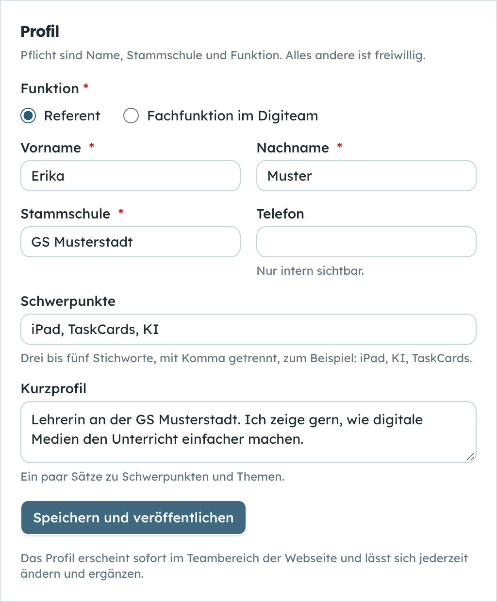
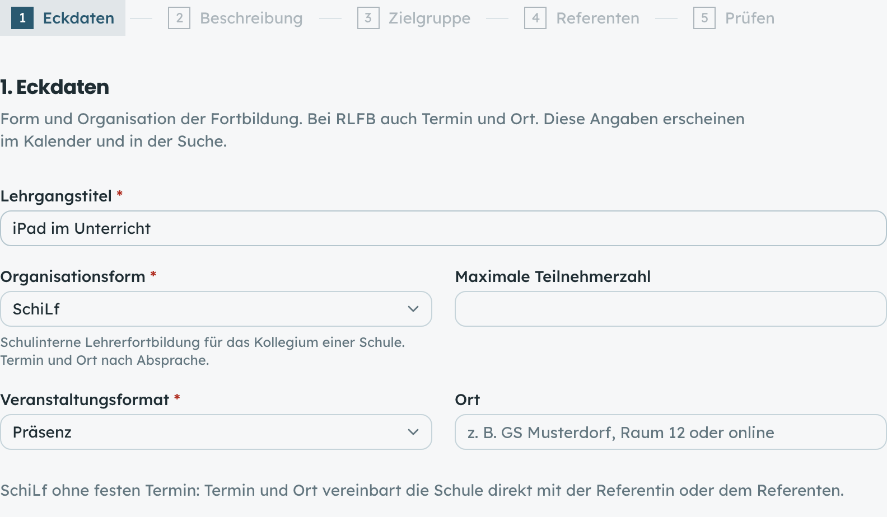
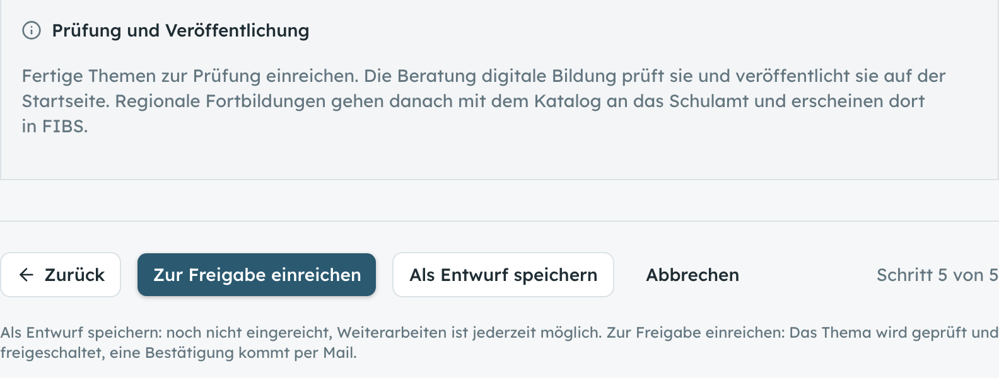

# Fortbildungsportal für ein Referentennetzwerk

Web-Anwendung, mit der eine Beratung digitale Bildung die Fortbildungen ihres
Referentennetzwerks sammelt, prüft und veröffentlicht. Referentinnen und
Referenten tragen ihre Themen selbst ein, die Beratung gibt frei, Lehrkräfte
finden alles auf einer öffentlichen Seite.

Das Projekt ist ein harter Fork von
[FortbildungenUAMM](https://github.com/BastiMuensch/FortbildungenUAMM) von
Sebastian Münsch (Schulamt Memmingen-Unterallgäu). Grundlage und Idee stammen
von ihm, der Fork geht eigene Wege und holt keine Updates mehr nach.

Die Oberfläche ist auf Deutsch. Fachbegriffe aus dem bayerischen Schulbereich
(SchiLf, RLFB, FIBS, DigCompEdu) bleiben unübersetzt.

> Dieser Stand ist ein bereinigter Bausatz: keine Echtdaten, keine
> Zugangsdaten, keine Verlaufshistorie. Die Beispieltexte gehören zu einem
> echten Landkreis und müssen angepasst werden, siehe
> [Anpassen an den eigenen Landkreis](#anpassen-an-den-eigenen-landkreis).

## Was die Anwendung kann

**Öffentlich, ohne Anmeldung**

- Startseite mit Reitern für SchiLf, regionale Fortbildungen und Kalender
- Liste der Fortbildungen mit Suche und Filtern (Schulart, Format, Schlagwort, DigCompEdu-Bereich, Niveaustufe)
- Monatskalender mit bayerischen Ferien und Feiertagen
- Detailseiten mit Teilnahmehinweis und Kalender-Abo per ICS (`/api/ics`)
- **Referentenbereich:** Auf der Startseite stellt „Wer wir sind“ die Mitglieder in einem Slider vor, direkt unter den Angeboten. Die Seite `/referenten` zeigt alle Mitglieder als Raster, der Steckbrief `/referenten/<id>` Porträt, Funktion, Stammschule, Schwerpunkte, Kurzprofil und die Angebote der Person als zwei Slider (regionale Fortbildungen, SchiLf). Ohne Kontaktdaten, Slider mit Tastatur bedienbar, Unbekanntes führt auf eine deutsche 404-Seite

**Intern, nach Anmeldung**

- **Einladungslink:** Jede Person bekommt einen persönlichen, einmal nutzbaren Link und setzt damit ihr Passwort
- **Profil mit Foto:** Stammschule, Schwerpunkte, Kurzprofil, Porträtfoto (wird serverseitig verkleinert). Referenten speichern mit „Speichern und veröffentlichen“, das Profil erscheint sofort im Referentenbereich. In der Referentenverwaltung gibt es einen Haken „Öffentlich sichtbar“ als Notbremse
- **Themen-Assistent:** fünf Schritte vom ersten Eintrag bis zum Prüfen, jederzeit als Entwurf speicherbar
- **Einreichen und Freigabe:** Referenten reichen ein, die Beratung gibt frei oder weist mit Begründung zurück
- **Mails:** Bestätigung beim Einreichen, Rückweisung, Einladung, Passwort-Reset (ohne SMTP landen sie nur im Log)
- **Terminumfrage** nach Art von Doodle, mit Onboarding für neue Referenten (Kontaktwege, weitere Formate)
- **Referentenverwaltung** mit Rollen (`ADMIN`, `REDAKTEUR`, `REFERENT`)
- **Katalog-Export** als PDF und Excel, dazu Aushang mit QR-Code und Auswertung

## So sieht es aus

Drei Ausschnitte aus dem Onboarding (Testperson „Erika Muster“, keine echten Daten):







## Schnellstart mit Docker Compose

Voraussetzung: Docker mit Compose. Die Schritte sind nicht auf jedem System
getestet, Rückmeldungen willkommen.

```bash
cp .env.example .env
```

In der `.env` setzen:

- `POSTGRES_PASSWORD`: zufälliger Wert, z. B. `openssl rand -hex 32`
- `JWT_SECRET`: zufälliger Wert, z. B. `openssl rand -base64 48`
- `APP_BASE_URL`: `http://localhost:3001`
- `SESSION_COOKIE_SECURE`: `false` (nur für den Test über http, im Betrieb `true`)
- `SEED_ADMIN_EMAIL` (in Kleinbuchstaben), `SEED_ADMIN_PASSWORD`, `SEED_ADMIN_NAME`

Starten:

```bash
docker compose up -d --build
```

Die App legt beim Start alle Migrationen an. Danach einmalig Stammdaten und
Admin-Konto einspielen. Das geht über das Builder-Image, weil der Seed Code aus
`src/` braucht:

```bash
set -a; . ./.env; set +a
docker build --target builder -t fortbildungsportal:builder .
docker run --rm --network "$(basename "$PWD")_default" \
  -e DATABASE_URL="postgresql://fortbildungen:${POSTGRES_PASSWORD}@db:5432/fortbildungen_uamm?schema=public" \
  -e SEED_ADMIN_EMAIL -e SEED_ADMIN_PASSWORD -e SEED_ADMIN_NAME \
  -e SCHULAMT_STARTPROFIL=neutral \
  fortbildungsportal:builder npx prisma db seed
```

Der Netzwerkname ist der Ordnername plus `_default`, im Zweifel mit
`docker network ls` nachsehen. Danach läuft die Seite auf
<http://localhost:3001>, der Redaktionsbereich unter `/admin`. Nach dem ersten
Login das Passwort ändern.

### Betrieb auf einem Server

- `docker-compose.override.yml.example` und `Caddyfile` zeigen einen Betrieb mit Caddy und HTTPS. Domain eintragen, Override-Datei auf dem Server umbenennen
- `APP_BASE_URL` auf die öffentliche HTTPS-Adresse setzen, `SESSION_COOKIE_SECURE` auf `true`
- `scripts/live.sh` und `scripts/testinstanz.sh` sind Beispielskripte für Deploy und Testinstanz per SSH und rsync. Server, Pfad und Adresse kommen aus Umgebungsvariablen (siehe Kopf der Skripte)

## Entwickeln ohne Docker für die App

Voraussetzung: Node.js 22 und ein PostgreSQL 16, z. B.:

```bash
docker run -d --name fortbildung-pg -e POSTGRES_PASSWORD=dev \
  -e POSTGRES_DB=fortbildungen_uamm -p 5432:5432 postgres:16-alpine
```

```bash
npm ci
cp .env.example .env     # DATABASE_URL und JWT_SECRET anpassen
npm run db:deploy
npm run db:seed
npm run dev
```

### Tests

- `npm run typecheck` prüft die Typen
- `npm test` führt die Prüfskripte aus (Logik, Auswertung, Einrichtung, Wächter für den Datenschutz). Sie brauchen keine Datenbank
- `npm run e2e` fährt einen Kettentest im Browser gegen eine **eigene Testinstanz** (Einladung, Passwort, Profil, Einreichen, Freigabe). Vorher `npm i --no-save playwright` und `npx playwright install chromium`. Gesetzt werden `E2E_BASIS` (Standard `http://localhost:3101`) und `E2E_ADMIN_PW`
- `scripts/e2e/randfaelle/` enthält Randfalltests (`rf-*.mjs`). Sie lesen Datenbank und Server-Log über SSH aus Docker-Containern mit den Namen `fortbildung-test-*`, passend zu `docker-compose.test.yml`. `TEST_SSH_HOST` nennt den Server
- Die Tests laufen nie gegen die Live-Seite

## Anpassen an den eigenen Landkreis

Der Beispieltext gehört zum Landkreis Aichach-Friedberg, die Beratung digitale
Bildung ist dort die Redaktion. Für einen anderen Landkreis:

| Was | Wo |
|---|---|
| Alle sichtbaren Texte, Mailtexte, Kontakt | `src/texte/teile/*` (`vorstellung.ts`, `aussen.ts`, `mails.ts`, `umfrage.ts`, `onboarding.ts`, `zugang.ts`) |
| Name und Region des Schulamts | `src/lib/schulamt.ts`, `src/lib/schulamtProfil.ts` |
| Absender und Kopie der Mails | `src/lib/mail.ts`, Variablen `MAIL_FROM` und `MAIL_BCC` |
| Logo, Banner, Figur | `public/bilder/`, `design/banner/` |
| Impressum und Datenschutz | im Admin-Bereich unter „Texte“ (der Seed legt nur Platzhalter an) |
| Veranstaltungsorte und Schulverzeichnis | Admin-Bereich „Orte“, Import-Vorlage in `public/vorlagen/` (der Einrichtungsassistent ist ausgeschaltet) |
| Funktionen ein- und ausschalten | `src/constants/funktionen.ts` (Objekt `AUSGEGRAUT`) |
| Farben und Schrift | `src/app/globals.css`, `src/app/layout.tsx`, `src/fonts/` |

Die Kontaktadresse in den Beispieltexten ist `kontakt@example.org`, der Name
der Kontaktperson steht noch im Beispiel. Beides ersetzen.

## Was gegenüber FortbildungenUAMM neu ist

- Referentenzugang mit persönlichen Einladungslinks statt eines offenen Registrierungsformulars
- Profil mit Funktion, Stammschule, Schwerpunkten, Kurzprofil und Porträtfoto
- Öffentlicher Referentenbereich: Mitglieder-Slider auf der Startseite, Übersichtsseite und Steckbrief je Person, nur mit öffentlichen Angaben (Sichtbarkeit entscheidet allein `oeffentlicheReferentWhere()`)
- Themen-Assistent in fünf Schritten, Entwurf in jedem Schritt speicherbar
- Einreichen und Freigabe: Referenten reichen ein, nur die Beratung veröffentlicht
- Rückweisung mit Begründung, Hinweis-Mail bei Änderung eines veröffentlichten Themas
- Transaktionsmails mit eigenem Absender, ohne SMTP nur Log
- Neue Formate: Micro-SchiLf, Online-Fortbildung, Video-Tutorial, SchiLf auf Abruf ohne Termin
- Niveaustufen mit Klartext (Einsteiger, Fortgeschrittene, Experten)
- Ort als Freitext statt fester Ortsliste
- Startseite neu: Motto, Reiter für SchiLf, Fortbildungen und Kalender, „Wer wir sind“ mit Mitglieder-Slider, Kontakt
- Dialoge passen sich dem sichtbaren Bildschirm an und scrollen in sich (auch am Handy), die Bearbeitungsmaske bleibt nach dem Speichern auf dem zuletzt offenen Reiter
- Terminumfrage nach Art von Doodle mit Serienmails und Erinnerung
- Onboarding für neue Referenten unter der Umfrage, Auswertung nur für Admins
- Einrichtungsfrist und Übersicht, wer noch nichts eingereicht hat
- Katalog-Export als PDF und Excel für das Schulamt
- Alle Texte zentral in `src/texte/`, Export als Textliste zur Abnahme (`scripts/textlisteExport.ts`)
- Sperren in der Datenbank gegen Doppelklicks und parallele Anfragen (`src/lib/sperren.ts`)
- Prüfung der Weiterleitung nach dem Login gegen Open Redirect
- Wächter-Tests, die Datenschutzregeln im Code absichern (`npm test`)
- Kettentest und Randfalltests im Browser, Deploy-Skript mit Klicktest

## Rückmeldung

Issues sind willkommen, auch kleine Beobachtungen. Das Projekt ist von einem
Hobby-Entwickler gebaut, dafür sind Hinweise von Erfahrenen besonders hilfreich.
Konkrete Fragen:

1. **Server Actions:** Alle Änderungen laufen über `src/actions/`, jede Aktion prüft die Rolle selbst (`requireRole()`). Ist die Struktur tragfähig, oder fehlen Schutzschichten?
2. **Token-Links:** Einladungs- und Umfragelinks sind signierte Tokens (`src/lib/umfrageToken.ts`, `src/lib/zugang.ts`). Reicht das Modell, wie sollte Ablauf und Entwertung aussehen?
3. **Testansatz:** Prüfskripte mit `tsx`, Browser-Tests mit Playwright gegen eine Testinstanz. Was würde ein üblicher Weg besser machen (Vitest, Playwright Test)?
4. **Sicherheit allgemein:** CSP ohne externe Ressourcen, Rate-Limit, Upload der Fotos. Was fehlt?
5. **Übertragbarkeit:** Was müsste sich ändern, damit andere Schulämter es mit wenig Aufwand einsetzen können?

## Lizenz

Noch offen. Die Lizenz wird mit Sebastian Münsch abgestimmt, bis dahin liegt
keine Lizenzdatei bei. Siehe [LICENSE.offen.md](LICENSE.offen.md).
